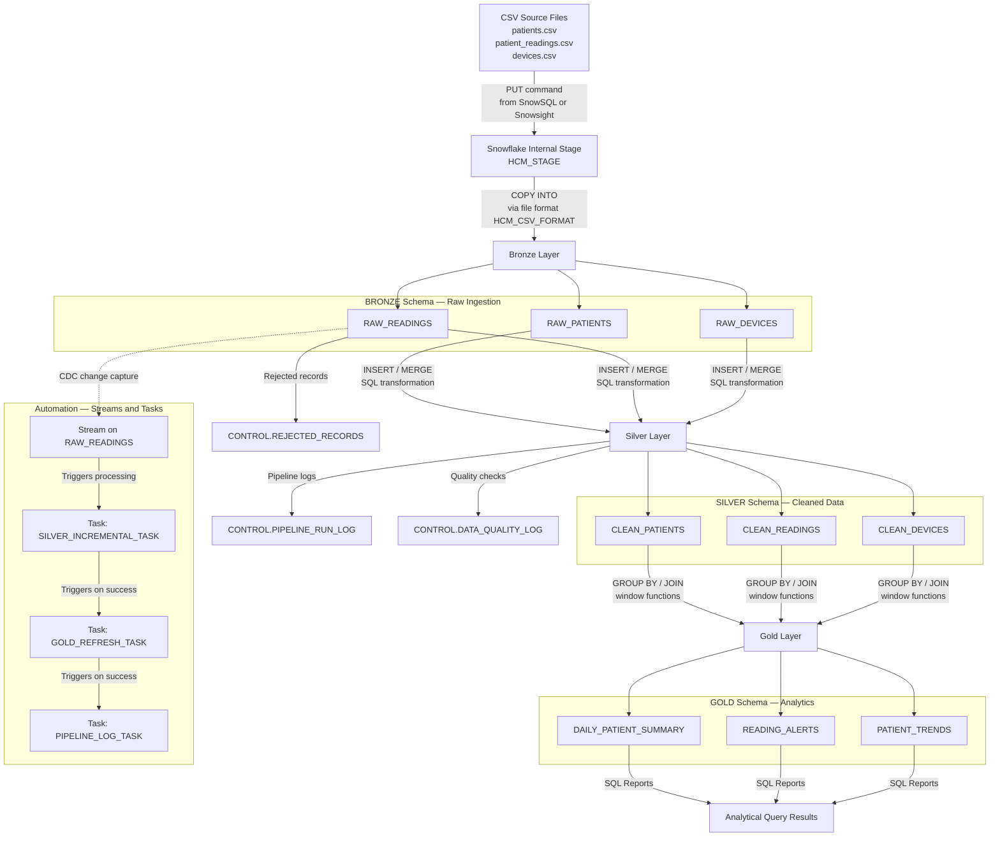

# Architecture — Healthcare Patient Monitoring Data Pipeline

## Overview

This document describes the architecture of the Healthcare Patient Monitoring
Data Pipeline built entirely on Snowflake SQL. It uses a Medallion (Bronze →
Silver → Gold) layered approach to ingest, clean, and analyse fictional patient
monitoring data.

---

## Data Flow Diagram



---

## Schema Design

The project uses a single Snowflake database `HEALTHCARE_MONITORING_DB` with
four schemas:

| Schema    | Purpose                                                                      |
|-----------|------------------------------------------------------------------------------|
| `BRONZE`  | Raw ingestion. All source data loaded as-is with VARCHAR types. Append-only. |
| `SILVER`  | Cleaned, typed, validated data. Bad records redirected to CONTROL.           |
| `GOLD`    | Aggregated analytics-ready tables. Refreshed from Silver.                    |
| `CONTROL` | Pipeline logs, quality logs, rejected records, threshold configuration.      |

---

## Layer Responsibilities

### Bronze Layer
- Accepts data exactly as it arrives from CSV files.
- All measurement columns stored as `VARCHAR` to prevent load failures from
  invalid values (e.g., `abc` in a numeric field).
- Adds `_source_file` and `_ingestion_timestamp` metadata columns.
- Never modified after initial load. Acts as the audit trail.
- Safe to reload: `COPY INTO` with `FORCE = FALSE` (default) skips already-loaded files.

### Silver Layer
- Casts VARCHAR to appropriate types using `TRY_TO_NUMBER` and `TRY_TO_TIMESTAMP`.
- Applies deduplication, reference validation, null checks, and plausibility rules.
- Records that fail any check go to `CONTROL.REJECTED_RECORDS` with a reason code.
- Valid records are inserted into `SILVER.CLEAN_*` tables.
- Provides the single trusted source for Gold aggregations.

### Gold Layer
- Joins `CLEAN_PATIENTS`, `CLEAN_READINGS`, and `CLEAN_DEVICES`.
- Produces three analytical tables: daily summary, reading alerts, and trends.
- Uses window functions (`LAG`, `ROW_NUMBER`, `RANK`) for trend analysis.
- Refreshed via `TRUNCATE + INSERT` or incremental `MERGE` on task execution.

### Control Schema
- `PIPELINE_RUN_LOG` tracks every pipeline execution with row counts and status.
- `DATA_QUALITY_LOG` records individual quality check results per run.
- `REJECTED_RECORDS` holds every rejected reading with its rejection reason.
- `QUALITY_THRESHOLDS` stores configurable plausibility min/max values.

---

## Automation Architecture

After the manual pipeline is validated, Snowflake Streams and Tasks automate
incremental processing.

```
RAW_READINGS (table)
    └── READINGS_STREAM (stream — captures new inserts/updates)
            └── SILVER_INCREMENTAL_TASK (scheduled or triggered)
                    └── GOLD_REFRESH_TASK (depends on SILVER task)
                            └── PIPELINE_LOG_TASK (depends on GOLD task)
```

- **Stream:** Attached to `BRONZE.RAW_READINGS`. Captures all new rows loaded
  via `COPY INTO` since the stream was last consumed.
- **Tasks:** Scheduled SQL tasks that consume the stream and drive each
  transformation layer.
- **Transaction safety:** The stream is consumed inside a transaction so that
  an error in Silver processing does not advance the stream offset.

See [`docs/automation_design.md`](automation_design.md) for full details.

---

## Technology Choices

| Concern              | Solution                                     | Reason                                      |
|----------------------|----------------------------------------------|---------------------------------------------|
| Data warehouse       | Snowflake                                    | Project requirement                         |
| Transformation       | Snowflake SQL (MERGE, CTE, window functions) | No external tools needed                    |
| Ingestion            | COPY INTO from internal stage                | Simple, serverless, audit-friendly          |
| Incremental loading  | Snowflake Streams + Tasks                    | Native CDC without external orchestration   |
| Data quality logging | CONTROL schema tables                        | Queryable from any SQL client               |
| Version control      | Git / GitHub                                 | Project requirement                         |

---

## Assumptions and Constraints

1. A Snowflake account with Standard Edition or above is required.
   (Streams and Tasks are available on Standard Edition.)
2. The executing role must have `SYSADMIN` or equivalent privileges to create
   databases, schemas, stages, file formats, tasks, and streams.
3. A warehouse of any size (X-SMALL is sufficient) is used for all SQL execution.
4. All SQL is written for Snowflake-compatible syntax. No Snowpark or external
   functions are used.
5. This is an educational project. No real patient data is processed.
